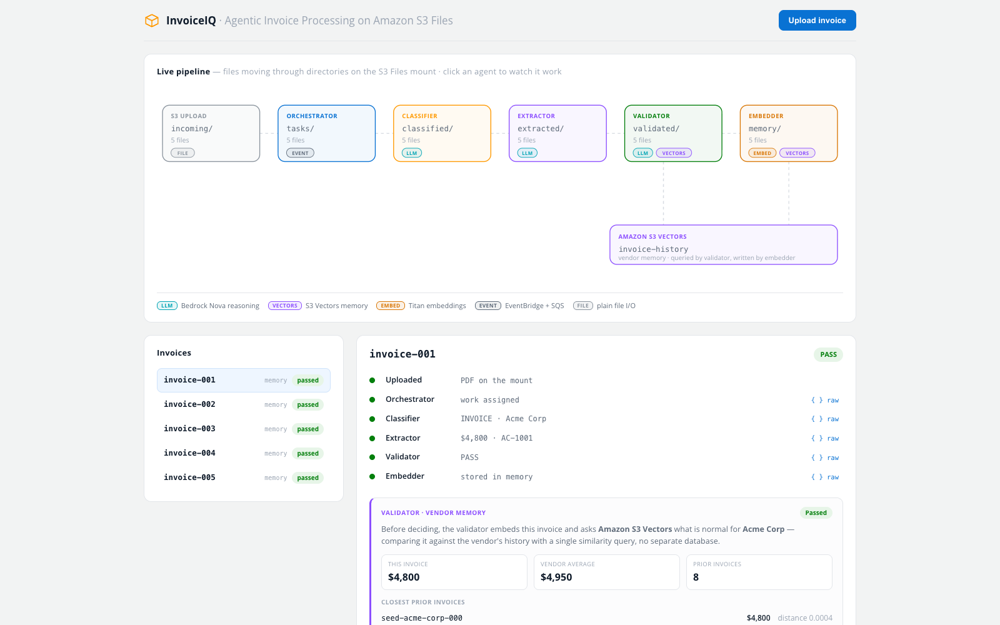
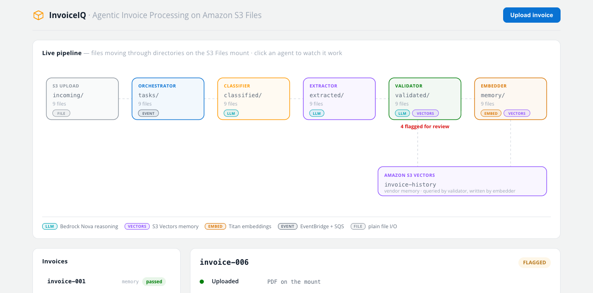
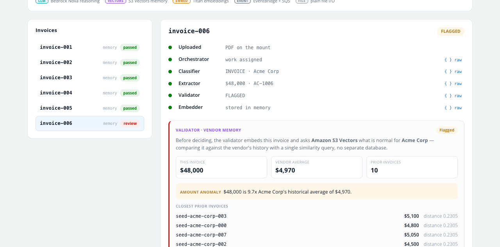
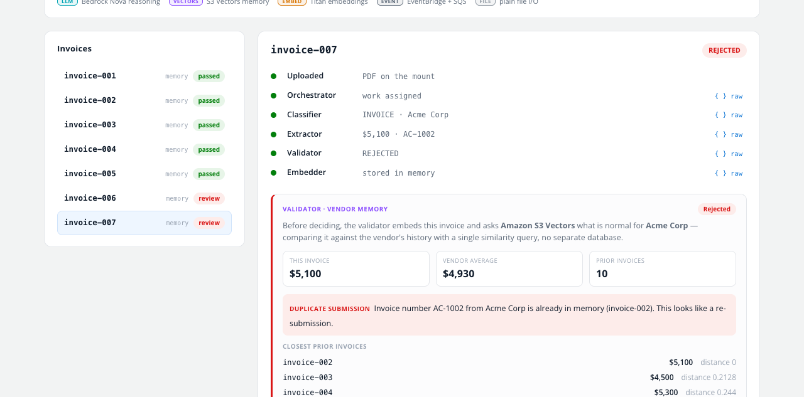
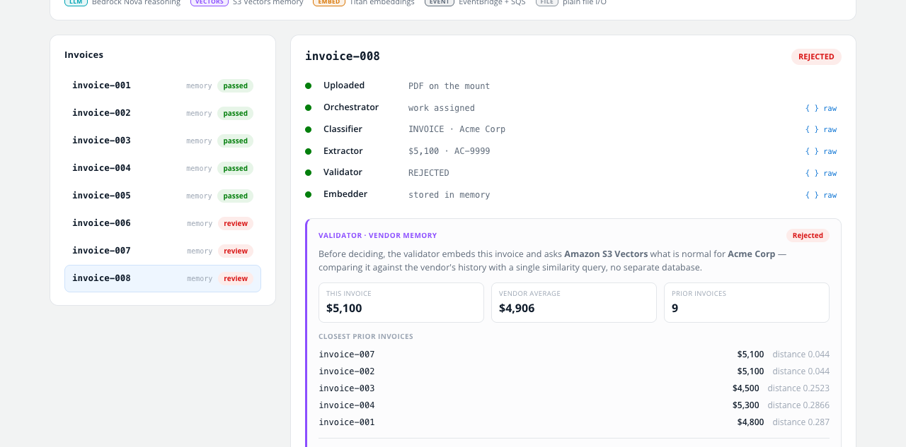

# InvoiceIQ: an agentic invoice pipeline on Amazon S3 Files and Amazon S3 Vectors

Build a multi-agent invoice-review pipeline in your own AWS account. Five agents on Amazon EKS
hand work to each other through a **shared file system** (Amazon S3 Files, so every file is also
an object in your S3 bucket), and the validator uses **Amazon S3 Vectors** as long-term memory of
each vendor's history to catch invoices that look fine on their own but break the pattern.
Amazon Bedrock supplies the models: Amazon Nova Pro for reasoning, Amazon Titan Text Embeddings V2
for the vectors.

```
 PDF ─► s3://.../incoming/     EventBridge ─► SQS fires on every new object
            │
            ▼
     ┌──────────────┐
     │ Orchestrator │ ── Titan embedding + S3 Vectors lookup (known vendor?)
     └──────┬───────┘
            ▼  tasks/
     ┌──────────────┐
     │ Classifier   │ ── Amazon Bedrock Nova Pro   (reads the PDF)
     └──────┬───────┘
            ▼  classified/
     ┌──────────────┐
     │ Extractor    │ ── Amazon Bedrock Nova Pro   (reads the PDF)
     └──────┬───────┘
            ▼  extracted/
     ┌──────────────┐
     │ Validator    │ ── Nova Pro + S3 Vectors vendor-history query
     └──────┬───────┘
            ▼  validated/      (anomalies ─► flagged/)
     ┌──────────────┐
     │ Embedder     │ ── Titan embedding ─► writes a vector to S3 Vectors
     └──────┬───────┘
            ▼  memory/

 Every stage directory above is one folder on a single shared mount, /mnt/s3files
 (Amazon S3 Files — each file is also an object in your S3 bucket). The dashboard
 (frontend + pipeline-api) reads that same mount.
```

This is the self-paced version of the workshop *"Building an Agentic workflow with Amazon S3
Vectors and Amazon S3 Files"*. It takes about **75–90 minutes**, most of it waiting for the EKS
cluster and container builds.

> [!WARNING]
> You will incur charges for the resources you create (EKS cluster and Auto Mode nodes, NAT
> gateway, S3 Files, S3 Vectors, Bedrock tokens, CodeBuild). Run [Cleanup](#cleanup) when done.

## Prerequisites

- An AWS account and a Region where **Amazon S3 Files, Amazon S3 Vectors, EKS Auto Mode and the
  Bedrock models below** are available. The defaults assume **us-west-2**. `AGENT_MODEL` defaults to
  the US cross-Region inference profile `us.amazon.nova-pro-v1:0`, so outside the US set it to
  the matching profile for your geography.
- **Amazon Bedrock model access** enabled for **Amazon Nova Pro** and **Amazon Titan Text
  Embeddings V2** in that Region.
- Permissions to create IAM roles, VPCs, EKS clusters, S3/S3 Files/S3 Vectors, SQS, EventBridge,
  ECR and CodeBuild (an administrator role in a sandbox account is simplest).
- Room for one more VPC in the Region (eksctl creates one), or use
  `config_files/eksctl_cluster_existing_vpc.yaml`.
- Tools: a recent [AWS CLI v2](https://docs.aws.amazon.com/cli/latest/userguide/getting-started-install.html)
  (it must include the `s3files` and `s3vectors` commands), [eksctl](https://eksctl.io/installation/),
  [kubectl](https://docs.aws.amazon.com/eks/latest/userguide/install-kubectl.html), `envsubst`
  (package `gettext`), `zip`, and Python 3.9+ with boto3 1.40 or newer. Older boto3 does not
  know Amazon S3 Vectors. A virtual environment avoids touching your system Python:
  `python3 -m venv .venv && source .venv/bin/activate && pip install --upgrade "boto3>=1.40.0"`.
  [AWS CloudShell](https://console.aws.amazon.com/cloudshell) works; install eksctl there first.

Check your CLI supports the newer services:

```bash
aws s3files help >/dev/null && aws s3vectors help >/dev/null && echo "CLI OK"
```

## Module 1 — Set up

### 1.1 Clone and configure

```bash
git clone https://github.com/<your-github-user>/invoiceiq-s3files-agents.git
cd invoiceiq-s3files-agents
export AWS_REGION=us-west-2          # change if you like
source config_files/env.sh
```

`env.sh` derives every value the walkthrough needs from your account. **Re-run
`source config_files/env.sh` whenever you open a new terminal or a step says so.**

### 1.2 Deploy the supporting infrastructure

One CloudFormation stack creates the invoice bucket, seven ECR repositories, the SQS intake queue
and EventBridge rule, the IAM roles, and a CodeBuild project that builds the images.

```bash
aws cloudformation create-stack --stack-name "$STACK_NAME" \
  --template-body file://config_files/infra_cfn.yaml --capabilities CAPABILITY_IAM
aws cloudformation wait stack-create-complete --stack-name "$STACK_NAME" && echo CREATE_COMPLETE
source config_files/env.sh
```

### 1.3 Create the EKS cluster (about 15–20 minutes)

```bash
envsubst < config_files/eksctl_cluster.yaml | eksctl create cluster -f -
kubectl get nodes   # Auto Mode adds nodes on demand, so "No resources found" is fine
```

While it builds, open a **second terminal** (`cd` into the repo, `export AWS_REGION=...`,
`source config_files/env.sh`) and continue with 1.4 and 1.5. Neither needs the cluster.

### 1.4 Build the container images (about 10 minutes)

```bash
./scripts/build_images.sh
```

### 1.5 Seed the vector memory and stage the sample invoices

The validator compares every invoice with the vendor's history. Seed a baseline of 14
historical invoices from three vendors:

```bash
python3 scripts/seed_memory.py
aws s3vectors get-index --vector-bucket-name "$VECTOR_BUCKET" --index-name "$VECTOR_INDEX" \
  --query 'index.{name:indexName,dim:dimension,metric:distanceMetric}'
```

You should see a 1024-dimension `cosine` index. Stage the sample invoices and reference data:

```bash
aws s3 cp samples/ "s3://$BUCKET_NAME/samples/" --recursive
echo '{ "anomaly_factor": 3, "near_duplicate_distance": 0.10, "category_distance": 0.45, "min_history_for_anomaly": 3 }' \
  | aws s3 cp - "s3://$BUCKET_NAME/reference/thresholds.json"
echo '{ "known_vendors": ["Acme Corp", "TechSupply Ltd", "CloudServe Solutions"] }' \
  | aws s3 cp - "s3://$BUCKET_NAME/reference/vendors.json"
```

## Module 2 — Amazon S3 Files on Amazon EKS

When the cluster is ready, refresh your environment so it picks up the VPC, security group and
private subnets:

```bash
source config_files/env.sh
```

### 2.1 Create the file system and mount targets

Amazon S3 Files exposes the bucket as an NFS file system. It needs the file system itself,
linked to the bucket, plus one mount target per Availability Zone inside the cluster VPC.
The script:

- creates the file system with the data-access role from the stack
- raises the import threshold under `incoming/` to 10 MiB, so invoice PDFs are cached on first
  directory access (the default is 128 KiB)
- sets a file-system policy that allows only the CSI node role to `ClientMount`, `ClientWrite`
  and `ClientRootAccess`
- creates a mount target in each private subnet with the cluster security group, which lets
  EKS nodes reach NFS port 2049

```bash
./scripts/create_file_system.sh
source config_files/env.sh
aws s3files get-synchronization-configuration --file-system-id "$S3FILES_FS_ID"
```

### 2.2 Install the EFS CSI driver

S3 Files mounts on EKS through the Amazon EFS CSI driver (version 3.0.0 or later). Bind each of
its two service accounts to its IAM role with EKS Pod Identity, then install the managed add-on:

```bash
aws eks create-pod-identity-association --cluster-name "$CLUSTER_NAME" --namespace kube-system \
  --service-account efs-csi-controller-sa --role-arn "$CSI_CONTROLLER_ROLE_ARN"
aws eks create-pod-identity-association --cluster-name "$CLUSTER_NAME" --namespace kube-system \
  --service-account efs-csi-node-sa --role-arn "$CSI_NODE_ROLE_ARN"

aws eks create-addon --cluster-name "$CLUSTER_NAME" --addon-name aws-efs-csi-driver
aws eks wait addon-active --cluster-name "$CLUSTER_NAME" --addon-name aws-efs-csi-driver
kubectl get pods -n kube-system -l app.kubernetes.io/name=aws-efs-csi-driver
```

On Auto Mode the node pod appears once the first workload brings up a node.

### 2.3 Mount with dynamic provisioning

The StorageClass makes the driver create an S3 Files access point for each claim. With
`basePath: "/"` and `subPathPattern: "."`, a pod sees the bucket root at `/mnt/s3files`. The claim
is `ReadWriteMany`, so every pod shares the same mount.

```bash
kubectl apply -f config_files/k8s/namespace.yaml
envsubst '$S3FILES_FS_ID' < config_files/k8s/storage.yaml | kubectl apply -f -
kubectl get pvc s3-files-pvc -n invoiceiq   # STATUS: Bound
```

### 2.4 Deploy the dashboard and four agents

Bind the agent and dashboard service accounts to their IAM roles, then deploy:

```bash
aws eks create-pod-identity-association --cluster-name "$CLUSTER_NAME" --namespace invoiceiq \
  --service-account invoiceiq-agent-sa --role-arn "$AGENT_ROLE_ARN"
aws eks create-pod-identity-association --cluster-name "$CLUSTER_NAME" --namespace invoiceiq \
  --service-account invoiceiq-pipeline-api-sa --role-arn "$PIPELINE_API_ROLE_ARN"

envsubst '$ECR_REGISTRY' < config_files/k8s/ui.yaml | kubectl apply -f -
envsubst '$ECR_REGISTRY $AWS_REGION $AGENT_MODEL $EMBED_MODEL $VECTOR_BUCKET $VECTOR_INDEX $SQS_QUEUE_URL' \
  < config_files/k8s/agents.yaml | kubectl apply -f -

for d in pipeline-api frontend orchestrator classifier extractor embedder; do
  kubectl rollout status deployment/$d -n invoiceiq --timeout=600s
done
```

The first rollout takes a few minutes while Auto Mode launches a node.

### 2.5 Create the pipeline directories and verify the mount

```bash
kubectl exec deployment/pipeline-api -n invoiceiq -- \
  mkdir -p /mnt/s3files/incoming /mnt/s3files/tasks /mnt/s3files/classified \
           /mnt/s3files/extracted /mnt/s3files/validated /mnt/s3files/flagged \
           /mnt/s3files/memory /mnt/s3files/reference
kubectl exec deployment/pipeline-api -n invoiceiq -- df -hT /mnt/s3files   # Type: nfs4
```

### 2.6 Open the dashboard

The dashboard is a `ClusterIP` Service and is not exposed to the internet, because its upload
endpoint has no authentication. Forward it to your machine:

```bash
kubectl port-forward -n invoiceiq svc/frontend 8080:80
```

Open <http://localhost:8080>. In CloudShell, run the command and use **Actions > Preview** on
port 8080 if available, or run kubectl from your laptop instead. Leave the port-forward running
in its own terminal. The pipeline is idle, with every stage at zero.

`kubectl port-forward` sometimes drops with `lost connection to pod`. If the dashboard stops
loading or an upload does nothing, re-run the command.

## Module 3 — Build the pipeline

### 3.1 See the pipeline

```bash
kubectl get pods -n invoiceiq -l tier=agent
```

Four agents are running. The **validator** is missing: you build it next. Each agent watches one
directory, reads the file the previous agent left, does its work, and writes the next one.
They never call each other.

| Agent | Watches | Writes | Bedrock (Nova Pro) | S3 Vectors / embeddings |
|---|---|---|---|---|
| Orchestrator | intake queue, `incoming/` | `tasks/` | No | Titan embedding + vendor lookup |
| Classifier | `tasks/` | `classified/` | Yes (reads the PDF) | None |
| Extractor | `classified/` | `extracted/` | Yes (reads the PDF) | None |
| Validator (you build it) | `extracted/` | `validated/`, `flagged/` | One-sentence recommendation | Vendor-history query drives the verdict |
| Embedder | `validated/` | S3 Vectors, `memory/` | No | Titan embedding + vector write |

### 3.2 Build the validator agent

Read [`validator/agent.py`](validator/agent.py). It embeds a description of the invoice's
**work** (`"<vendor> | <category> | <line items>"`, not the amount) and runs one vendor-filtered
S3 Vectors query. Four checks are then decided in code:

- **Amount anomaly:** the amount is more than `ANOMALY_FACTOR` (3) times the vendor's approved
  average. Verdict FLAGGED.
- **Exact duplicate:** a prior invoice has the same invoice number. Verdict REJECTED.
- **Near-duplicate:** a prior invoice sits within `NEAR_DUP_DISTANCE` (0.10) cosine distance but
  carries a different invoice number. Verdict REJECTED.
- **Category anomaly:** even the nearest prior invoice is farther than `CATEGORY_DISTANCE`
  (0.45). Verdict FLAGGED.

The model is asked only to phrase the decision in one sentence. Ship the code as a ConfigMap
into a stock Python image:

```bash
kubectl create configmap validator-code -n invoiceiq --from-file=validator/agent.py
envsubst '$AWS_REGION $AGENT_MODEL $EMBED_MODEL $VECTOR_BUCKET $VECTOR_INDEX' \
  < config_files/k8s/validator.yaml | kubectl apply -f -
kubectl rollout status deployment/validator -n invoiceiq --timeout=300s
kubectl logs -n invoiceiq -l app=validator --tail=3   # [validator] watching /mnt/s3files/extracted
```

After you edit `agent.py`, run
`kubectl create configmap validator-code -n invoiceiq --from-file=validator/agent.py --dry-run=client -o yaml | kubectl apply -f -`
and then `kubectl rollout restart deployment/validator -n invoiceiq`.

### 3.3 Upload invoices and watch

Send the first invoice from the dashboard: choose **Upload invoice**, then pick
`samples/invoice-001.pdf`. Send the other four from the terminal:

```bash
for i in 002 003 004 005; do
  aws s3 cp "s3://$BUCKET_NAME/samples/invoice-$i.pdf" "s3://$BUCKET_NAME/incoming/invoice-$i.pdf"
done
```

Within about a minute, the **dashboard** shows all five invoices reach `memory/`, each with a
green `PASS` verdict.

Then confirm from the terminal that the outputs are real files on the mount. This command prints
the number of files in each stage directory (it reports counts, not verdicts):

```bash
kubectl exec deployment/pipeline-api -n invoiceiq -- sh -c \
  'for d in incoming classified extracted validated memory; do echo "$d: $(ls /mnt/s3files/$d | wc -l)"; done'
```

```text
incoming: 5
classified: 5
extracted: 5
validated: 5
memory: 5
```

The original PDFs stay in `incoming/`; each stage also keeps the envelope it wrote, so every
directory holds all five.



### 3.4 Trace the handoffs, then prove the agents are disposable

Print what each stage wrote for one invoice:

```bash
kubectl exec deployment/pipeline-api -n invoiceiq -- sh -c \
  'for f in tasks classified extracted validated; do echo "== $f"; cat /mnt/s3files/$f/invoice-001.json; echo; done'
```

Each file is a small JSON envelope. `classified/invoice-001.json`, for example, shows the
classifier skipped its Bedrock call because the orchestrator recognized the vendor at intake:

```json
{
  "document_type": "INVOICE",
  "vendor_name": "Acme Corp",
  "category": "IT Services",
  "reasoning": "Recognized at intake; classification reused from vendor memory, Nova classify skipped.",
  "confidence": 1.0,
  "classify_skipped": true,
  "recognition": { "reason": "recognized", "nearest_key": "invoice-002", "distance": 0.2472, "threshold": 0.35 },
  "invoice_id": "invoice-001",
  "classified_at": "2026-10-28T16:38:34Z"
}
```

Take the extractor offline, strand one invoice mid-pipeline, then bring up a brand-new pod:

```bash
kubectl scale deployment/extractor -n invoiceiq --replicas=0
kubectl wait --for=delete pod -l app=extractor -n invoiceiq --timeout=60s
kubectl exec deployment/pipeline-api -n invoiceiq -- rm -f /mnt/s3files/extracted/invoice-005.json
kubectl scale deployment/extractor -n invoiceiq --replicas=1
sleep 30
kubectl exec deployment/pipeline-api -n invoiceiq -- ls -l /mnt/s3files/extracted/invoice-005.json
```

```text
-rw-r--r--. 1 root root 547 /mnt/s3files/extracted/invoice-005.json
```

The new pod finds the waiting `classified/` file and finishes the work. Recovery needs no queue
to drain and no offset to replay. Everything the agents wrote is also an object in your bucket
(`aws s3 ls "s3://$BUCKET_NAME/validated/"`), even though they only used `open()` and `write()`.

## Module 4 — Vector memory

### 4.1 Explore the memory

```bash
python3 scripts/query_memory.py
```

```text
seed-acme-corp-000           $   4800  distance=0.019
seed-acme-corp-001           $   5200  distance=0.019
seed-acme-corp-002           $   4500  distance=0.019
seed-acme-corp-003           $   5100  distance=0.019
seed-acme-corp-004           $   4950  distance=0.019
seed-acme-corp-005           $   5300  distance=0.019
seed-acme-corp-006           $   4700  distance=0.019
seed-acme-corp-007           $   5050  distance=0.019
invoice-004                  $   5300  distance=0.213
invoice-005                  $   4950  distance=0.214

Acme Corp average: $4,985 over 10 invoices
```

The output lists Acme Corp's nearest invoices and their average (about $5,000). The eight seeds
share one distance because they were embedded from identical text; `invoice-004` and
`invoice-005` from Module 3 are now part of memory too.

### 4.2 Catch the anomalies

Send four invoices that each look clean on their own. Send them one at a time and click each one
on the dashboard to see why it was caught:

```bash
send() { aws s3 cp "s3://$BUCKET_NAME/samples/invoice-$1.pdf" "s3://$BUCKET_NAME/incoming/invoice-$1.pdf"; }
send 006   # $48,000 from Acme Corp
send 007   # reuses invoice number AC-1002 (invoice 002)
send 008   # invoice 002 again, renumbered AC-9999 and reworded
send 009   # $5,000 for landscaping, a kind of work Acme never bills
```

| Invoice | Expected verdict | Caught by |
|---|---|---|
| 006 | FLAGGED | Amount anomaly: about 9.7 times the vendor average (metadata) |
| 007 | REJECTED | Exact duplicate of `AC-1002` (metadata) |
| 008 | REJECTED | Near-duplicate of `AC-1002` (invoices 002 and 007), cosine distance about 0.04 (vectors) |
| 009 | FLAGGED | Category anomaly, nearest distance about 0.72 (vectors) |

The pipeline view shows all nine invoices processed, four of them flagged for review:



Click invoice 006 on the dashboard to see the amount-anomaly callout: $48,000 against the
vendor's historical average, a 9.7x jump.



Invoice 007 reuses invoice number `AC-1002`, so the validator rejects it as an exact duplicate:



A database lookup could make the first two calls. The last two depend on where the invoice lands
in vector space. The full verdict is in each envelope:

```bash
kubectl exec deployment/pipeline-api -n invoiceiq -- cat /mnt/s3files/validated/invoice-008.json
```

```json
{
  "invoice_id": "invoice-008",
  "invoice_number": "AC-9999",
  "vendor": "Acme Corp",
  "amount": 5100.0,
  "validation_status": "REJECTED",
  "near_duplicate": {
    "flagged": true,
    "matched_key": "invoice-007",
    "matched_invoice_number": "AC-1002",
    "distance": 0.044
  }
}
```

(Abbreviated: the real envelope also carries `history`, `anomaly`, and `duplicate` blocks. The
nearest match is `invoice-007`, which reused invoice number `AC-1002` from invoice 002.)



The dashboard draws a callout box only for the amount and exact-duplicate checks. For 008 and
009, the verdict and recommendation still appear, and the envelope shows the `near_duplicate` or
`category_anomaly` block.

### 4.3 Going further

Find the threshold's edge. Only the threshold changes between these two runs, and the verdict
flips:

```bash
python3 scripts/whatif.py 48000 3    # FLAGGED
python3 scripts/whatif.py 48000 12   # PASS
```

The only difference between the two runs is the threshold, and the verdict flips:

```text
$ python3 scripts/whatif.py 48000 3
Vendor:            Acme Corp
Approved average:  $4950.0 over 8 invoices
This invoice:      $48,000  (9.7x the average)
Threshold:         3.0x  (ANOMALY_FACTOR)
Verdict:           FLAGGED (amount anomaly)

$ python3 scripts/whatif.py 48000 12
Vendor:            Acme Corp
Approved average:  $4950.0 over 8 invoices
This invoice:      $48,000  (9.7x the average)
Threshold:         12.0x  (ANOMALY_FACTOR)
Verdict:           PASS
```

Use memory to cut cost. An invoice close to the vendor's history can reuse its classification
and skip one of the two full-PDF model reads, roughly halving its tokens. Only the
classification can be reused: the amount, date and invoice number are always read fresh.

```bash
python3 scripts/cache_probe.py "Acme Corp" "Acme Corp | IT Services | Managed IT support - March"   # RECOGNIZED
python3 scripts/cache_probe.py "Acme Corp" "Acme Corp | Legal | Patent litigation counsel"         # NEW
```

```text
$ python3 scripts/cache_probe.py "Acme Corp" "Acme Corp | IT Services | Managed IT support - March"
Incoming: Acme Corp | IT Services | Managed IT support - March
Nearest in memory: invoice-003  distance=0.000  (threshold 0.35)
RECOGNIZED  ->  reuse classification (skip the classify pass); extract amount/date/number fresh

$ python3 scripts/cache_probe.py "Acme Corp" "Acme Corp | Legal | Patent litigation counsel"
Incoming: Acme Corp | Legal | Patent litigation counsel
Nearest in memory: seed-acme-corp-003  distance=0.576  (threshold 0.35)
NEW         ->  full processing (classify + extract)
```

The orchestrator already does this at intake. Classifier logs show
`reusing classification (no Bedrock call)` for recognized invoices:

```bash
kubectl logs -n invoiceiq -l app=classifier --tail=20
```

```text
[classifier] invoice-001 recognized at intake -> reusing classification (no Bedrock call)
```

Ideas to take further:
- Add an agent that watches `flagged/` and routes anomalies to a reviewer.
- Scale an agent on the file count in its input directory.
- Derive the thresholds per vendor instead of using fixed constants.

## Cleanup

```bash
source config_files/env.sh
./scripts/cleanup.sh
```

The script asks for confirmation, then deletes everything in dependency order:

1. The Kubernetes namespace and StorageClass
2. The S3 Files file system: policy, mount targets and access points first
3. The S3 Vectors index and bucket
4. The contents of both buckets, including every object version
5. The EKS cluster
6. The CloudFormation stack

It takes about 20–25 minutes. Afterwards, check the CloudFormation console for a leftover
`eksctl-<cluster>-*` stack.

## Troubleshooting

- **PVC stays `Pending`, or pods fail with `access denied by server`.** Confirm the
  file-system policy names `$CSI_NODE_ROLE_ARN`
  (`aws s3files get-file-system-policy --file-system-id $S3FILES_FS_ID`). Also confirm both CSI
  Pod Identity associations exist and that all mount targets are `available`.
- **Pods stuck in `ContainerCreating` with a mount timeout.** The mount targets need the
  cluster security group:
  `aws s3files get-mount-target --mount-target-id <id> --query securityGroups`.
- **Agents log Bedrock `AccessDeniedException`.** Enable model access for Nova Pro and Titan
  Text Embeddings V2, and check that `AGENT_MODEL` is valid in your Region.
- **CodeBuild fails on `pip install` or `npm ci`.** These are usually transient upstream
  errors. Re-run `./scripts/build_images.sh`.
- **`eksctl create cluster` fails with `VpcLimitExceeded`.** Use
  `config_files/eksctl_cluster_existing_vpc.yaml` with two private subnets that have NAT
  egress.

- **Dashboard upload does nothing.** The port-forward probably dropped; re-run
  `kubectl port-forward -n invoiceiq svc/frontend 8080:80`.
- **`Unknown service: 's3vectors'`.** Your boto3 is too old; see Prerequisites.

## Security

- The dashboard and its upload API are reachable only through `kubectl port-forward`. Do not
  change the Service to `LoadBalancer` without adding authentication.
- All buckets block public access. IAM roles are scoped to this walkthrough's resources, and the
  S3 Files file-system policy allows a single principal.
- This is sample code for learning, not a production invoice system.

## License

This library is licensed under the MIT-0 License. See the [LICENSE](LICENSE) file.
